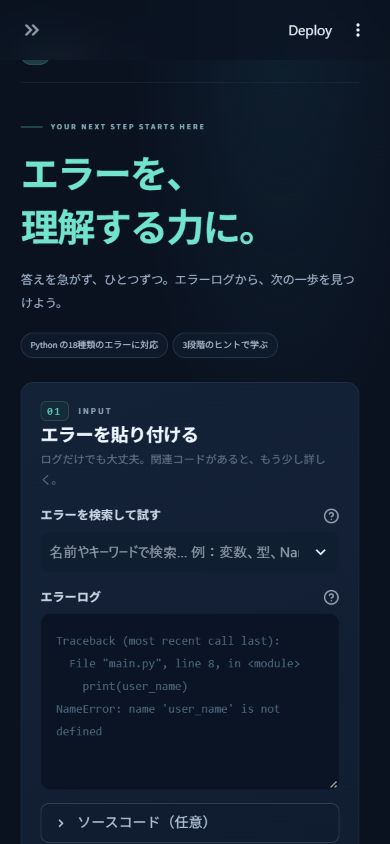
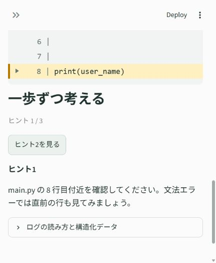
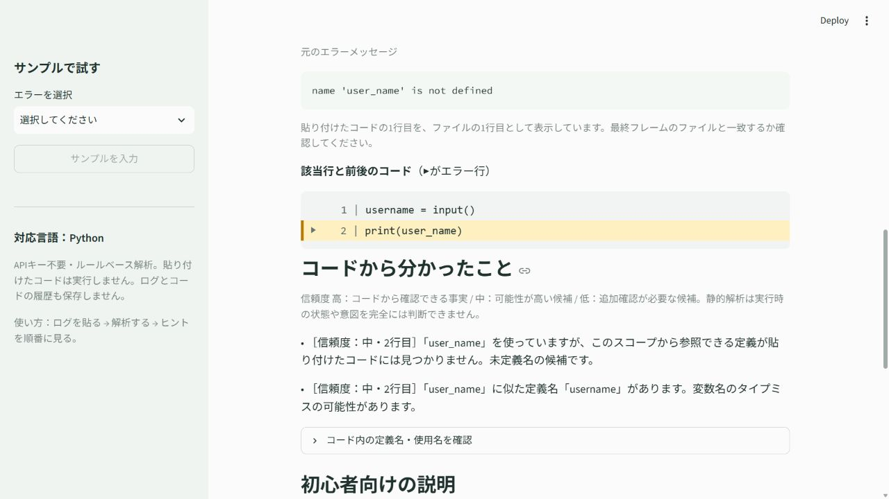

# 初心者向けプログラミングエラー解析アシスタント


**最新版 v3**は、ASTの診断根拠を広げ、検索候補・段階式ヒント・読み込みスケルトンを備えた画面へ更新しました。実装固定後の30件では誤警告が1件（3.33%）あり、制御フロー解析の限界として記録しています。

| v3評価 | 実測値 |
| --- | ---: |
| 42ケース AST診断精度（構造化採点） | 91.67% (33/36) |
| 42ケース Strict PASS | 88.10% (37/42) |
| 旧holdout Strict PASS | 100% (20/20) |
| 新しい正常コードへの誤警告 | 3.33% (1/30) |
| pytest | 496 passed |

新規ケースは外部の盲検ベンチマークではありません。測定条件・旧採点との比較・残る失敗は[評価レポート](evaluation/v3/REPORT.md)を参照してください。




Pythonのエラーを「読める」「確認できる」に変える、大学生向けの学習支援ツールです。
Streamlitで動作し、LLM APIやAPIキーがなくても使えます。

## プロジェクト概要

エラーログと任意のソースコードを入力すると、ログをPythonで解析し、
エラー種類・ファイル名・行番号・対象の名前・カテゴリを構造化します。
その情報から初心者向け説明、確認ポイント、3段階のヒント、学習用の修正例を生成します。

**処理の中心は正規表現によるログ解析とルールベースの教育ロジックです。**
構造化データ、説明生成、ヒント生成、UIを分け、解析の結果をテストできる設計にしました。

解析は**「ルールベースのログ解析」＋「ASTによるコード文脈解析」**の2段階です。
コードが入力された場合だけPython標準の`ast`と`symtable`で補助解析し、
「このコードでは何を確認すべきか」を信頼度付きで示します。コードがなければ従来のログ解析だけで動きます。



## 作った理由

大学のプログラミング授業で「エラー文の意味が分からず、そこで学習が止まる学生が多い」
という課題を設定しました。特に、どこで失敗したか、どの名前や操作を見るべきか、
次に何を確認すればよいかが分からないと、自力で調べることも難しくなります。

このツールは、エラーメッセージを読む順序と具体的な確認行動を示し、
学生が次回は自分でエラーを読み解けるようになることを目指しています。
実際の学生への効果検証は、今後の課題です。

## 主な機能

- Python tracebackからエラー種類、メッセージ、ファイル名、行番号、対象を抽出。
- 主要18種類を分類し、平易な日本語で説明・確認ポイントを表示。
- **通常モード / ヒントモード**を画面から切り替え。
- ヒントを1つずつ表示し、3つを見た後に希望した場合だけ修正例を表示。
- ソースコードがあれば該当行と前後2行を表示し、該当行を背景色と▶で強調。
- 入力を変えたら古い結果を消去。表示モードを変えたらヒントの進み具合をリセット。
- 12種類のサンプルをサイドバーから入力して体験。
- 不完全なログや未知の例外では、取得できた情報と追加で必要な情報を表示。
- ANSI色コード、Windowsのパス、CRLF、複数のフレーム、通常の例外の連鎖に対応。
- 構造化情報を画面で確認可能。入力コードは実行せず、ログ・コードの履歴も保存しない。
- ASTで未定義名・似た定義名・定義前参照・import・属性アクセス・明白な範囲外アクセスを補助解析。
- 明確なリテラルの型・値、直接定義された関数の引数、簡単な分岐・ループ・例外処理を補助解析。
- 「コードから分かったこと」に信頼度付きの結果を表示し、ASTの情報からヒントも具体化。

## システム構成

```text
入力（ログ / 任意コード）
  ↓
parser.py        正規表現 / tracebackのフレーム抽出 / 最終例外の判定
  ↓
models.py        ParsedErrorとして構造化
  ↓
analyzer.py      エラー分類 / コードの前後行の抽出
  ↑
code_analysis.py コードがある場合のみAST + symtableで文脈・スコープを解析
literal_analysis.py 明確な型・値の伝播 / 引数照合 / 簡単な経路の合流
  ↓
explanations.py  日本語の説明テンプレート / 確認ポイント / 学習用修正例
  ↓
hints.py         ログとASTの情報から、場所 → 注目点 → 確認行動の3段階
  ↓
app.py           Streamlit UI / モード切り替え / 表示の段階管理
```

データの例：

```json
{
  "language": "python",
  "error_type": "NameError",
  "message": "name 'user_name' is not defined",
  "file": "main.py",
  "line": 8,
  "target": "user_name",
  "category": "variable",
  "status": "complete"
}
```

実際にはフレームの一覧と警告も保持します。取得できない値は`None`（JSONでは`null`）です。
`status`は、ファイル・行番号・メッセージが揃うと`complete`、一部だけなら`partial`、
種類も場所も分からなければ`unrecognized`です。`complete`は原因が確定したことを意味しません。

通常の例外が連鎖しているログでは**最後の例外と、それに属する最後のフレーム**を主結果にします。
以前の例外の行番号を、後の例外に流用しません。

```text
error-learning-assistant/
├── README.md
├── VERIFICATION.md
├── requirements.txt
├── pytest.ini
├── .gitignore
├── .streamlit/
│   └── config.toml
├── app.py
├── src/
│   ├── __init__.py
│   ├── models.py
│   ├── parser.py
│   ├── analyzer.py
│   ├── code_analysis.py
│   ├── literal_analysis.py
│   ├── explanations.py
│   ├── hints.py
│   └── view.py
├── tests/
│   ├── test_parser.py
│   ├── test_analyzer.py
│   ├── test_app.py
│   ├── test_samples.py
│   ├── test_code_analysis.py
│   ├── test_diagnostics_v2.py
│   └── test_app_ast.py
├── examples/
│   └── sample_errors.json
└── docs/
    ├── app-preview.jpg
    └── ast-preview.jpg
```

## 対応エラー

| エラー | カテゴリ | 主に確認すること |
| --- | --- | --- |
| SyntaxError | 文法 | コロン、括弧、引用符、直前の行 |
| IndentationError | 字下げ | 処理のまとまり、空白の数、タブとスペース |
| NameError | 変数・名前 | 定義の順序、スペル、使える範囲 |
| TypeError | データの種類 | 型、演算、関数の呼び出し方 |
| ValueError | 値の内容 | 変換する値、入力内容 |
| IndexError | リストなどの位置 | 長さ、0から始まる位置、空のリスト |
| KeyError | 辞書のキー | キーの存在、スペル、型 |
| AttributeError | 属性・メソッド | データの型、その型にある機能、None |
| ModuleNotFoundError | モジュール | 名前、インストール、実行環境 |
| ImportError | 読み込み | 名前、バージョン、循環import |
| FileNotFoundError | ファイル | パス、拡張子、現在の作業フォルダ |
| ZeroDivisionError | 計算 | 割る数、途中の計算、0の場合の分岐 |
| UnboundLocalError | 変数・名前 | 関数内の代入と参照の順序、ローカル変数 |
| RecursionError | 再帰 | 終了条件、問題を小さくする処理、呼び出しの深さ |
| StopIteration | イテレータ | nextの呼び出し、空・取り出し済みの要素 |
| AssertionError | 条件確認 | assertの条件、期待値と実際の値 |
| RuntimeError | 実行時 | メッセージ、走査中の辞書・集合の変更 |
| UnicodeDecodeError | 文字コード | bytes、復号に使う文字コード、入力元の形式 |

未知の例外も、標準的な`RuntimeError: message`や`CustomFailure: message`の形式なら
種類とメッセージを取得します。専用の説明がない場合、原因や修正例を断定せず、調査の出発点を案内します。

## 実行方法

Python **3.10以上**が必要です。検証環境はPython **3.12.14**、Streamlit **1.65.0**、pytest **9.1.1**です。
Pythonとpipが使える環境で、プロジェクトフォルダへ移動してください。

### Windows / PowerShell

```powershell
cd error-learning-assistant
py -3 -m venv .venv
.\.venv\Scripts\python.exe -m pip install -r requirements.txt
.\.venv\Scripts\python.exe -m streamlit run app.py
```

`py`がない環境で`python`が使える場合は、最初の`py -3`を`python`に置き換えてください。
仮想環境の有効化は不要です。

### macOS / Linux

```bash
cd error-learning-assistant
python3 -m venv .venv
.venv/bin/python -m pip install -r requirements.txt
.venv/bin/python -m streamlit run app.py
```

起動後、ブラウザで[http://localhost:8501](http://localhost:8501)を開きます。
設定で自動ブラウザ起動を止めているため、URLを自分で開いてください。
終了するときは起動したターミナルで`Ctrl+C`を押します。
他のアプリがポートを使っている場合は`--server.port 8502`などを追加します。

### テスト

```powershell
# Windows: プロジェクトフォルダから実行
.\.venv\Scripts\python.exe -m pytest -q
```

```bash
# macOS / Linux
.venv/bin/python -m pytest -q
```

パーサー・分類・説明・前後行の表示に加え、Streamlitの
[AppTest](https://docs.streamlit.io/develop/api-reference/app-testing/st.testing.v1.apptest)で、
ヒントの段階、修正例の明示的な表示、モード切り替え、入力変更、サンプル選択を検証します。
サンプルの修正例は固定の開発者データとして別プロセスで実行し、正常終了を確認します。
アプリが学生の入力コードを実行することはありません。

v2改善前のアプリ208テストは変更せずに維持しています。v2時点でアプリは計319件、
評価器は元の34件に8件を加え計42件、合計361件が成功しました。
アプリの新規111実行例には105件の新規診断テストと、説明テンプレート追加による6件の検証を含みます。
追加のAST用テストでは、
名前とスコープ、類似名、定義前参照、importとの対応、属性、範囲外アクセス、
正常なコードの誤警告防止、構文エラー時のフォールバック、ヒントの段階表示を検証します。

## 使用例

1. 左のサイドバーで「NameError｜まだ作っていない変数」を選ぶ。
2. 「サンプルを入力」を押し、ログとコードを確認する。
3. 「解析する」を押す。
4. ヒントを順番に確認し、自力で修正を考える。
5. 必要なら3つ目のヒントの後で「修正例を見る」を押す。

ログだけの入力も可能です。

```text
NameError: name 'user_name' is not defined
```

通常モードの出力例：

```text
エラー種類：NameError
カテゴリ：変数・名前
場所：取得できませんでした（Traceback全体があれば抽出可能）

説明：Pythonが「user_name」という名前を使おうとしましたが、その場所で見つけられませんでした。
原因：変数が使用前に作られていない、スペルが違う、または使える範囲の外にある可能性があります。

確認ポイント：
1. その名前を使う前に値を代入しているか。
2. 大文字・小文字を含め、定義した名前とスペルが一致するか。
3. 関数の中で作った変数を、関数の外から使っていないか。
```

学習用の修正例：

```python
user_name = "Taro"
print(user_name)
```

ファイル名と行番号も表示したい場合：

```text
Traceback (most recent call last):
  File "main.py", line 8, in <module>
    print(user_name)
NameError: name 'user_name' is not defined
```

ソースコードは、ログに表示されたファイル全体を1行目から貼り付けてください。
8行目があれば前後2行と一緒に強調表示します。コードが短く8行目がなければ、
行番号のずれを案内します。コードを貼らなくてもログだけで解析できます。

## 教育用途として工夫した点

**答えをそのまま提示するのではなく、段階的にヒントを出して自力解決を支援する**設計です。
初期表示はヒントモードにして、原因説明や修正例を先に見せません。

| 段階 | 表示する内容 | 学生に促す行動 |
| --- | --- | --- |
| ヒント1 | ファイル・行番号、またはログを読む場所 | エラー箇所を探す |
| ヒント2 | 対象の名前、またはエラー種類とメッセージ | 注目する名前や操作を絞る |
| ヒント3 | 最初に確認すべき具体的なポイント | 仮説を立てて確認する |
| 修正例 | ユーザーが選んだ場合のみ表示 | 自分の考えと比較する |

「エラーの意味」「考えられる原因」「次に確認すること」を分け、断定しすぎない説明を使います。
最後のエラー行 → 直前の`File`・`line` → コードの対象、という読み方も表示します。
修正例は学習用の例であり、貼り付けたコードにそのまま適用する自動修正ではありません。
通常モードではまとめて復習できるようにしています。

## ASTによるコード文脈解析

入力コードは実行せずに構文木へ変換します。`symtable`で組み込み名、import名、
引数、関数のローカル変数、外側の変数を区別し、名前を定義名一覧だけで単純比較しない設計です。
クラスの属性はメソッドから裸の変数名では参照できない点や、内包表記の変数が外へ漏れない点も考慮します。

| 解析項目 | 検出・表示する内容 |
| --- | --- |
| 未定義名の候補 | そのスコープから参照できる定義が入力コードに見つからない名前 |
| 類似名 | 参照できる定義名との文字列の類似度によるタイプミス候補 |
| 定義前参照 | 値を与える処理より前に同じスコープで名前を使う形、代入の右辺も確認 |
| import | モジュール名、読み込む名前、別名、行番号を抽出してログの対象と対応付け |
| 属性アクセス | 式と行番号を示す。正確な組み込みリテラル型が分かる場合のみ属性不足も指摘 |
| 型・値の伝播 | int / float / str / bytes / list / tuple / dict / set / None / boolの明確なリテラルを追跡 |
| 演算・変換 | 型の合わない加算・大小比較、0での除算・剰余、明白に失敗するint変換 |
| 添字・辞書 | 明白な範囲外、float等の不正な位置番号、存在しない定数キー、ハッシュ不可能なキー |
| 関数引数 | 同一コードの直接の関数定義と呼び出しを照合。不足・位置引数過多・未知keyword・重複を確認 |
| 簡単な経路 | ifの合流、空ループ、全経路で定義されない名前、捕捉できる標準例外を確認 |

通常モードでは「コードから分かったこと」に補助情報を表示します。
ヒントモードでは同セクションの詳細を最初は隠し、3つのヒントを確認した後に表示します。
修正例は引き続き、希望してボタンを押した場合だけ表示します。
コードが構文エラーなどで解析できなければ、その理由を表示して既存のログ解析・ヒントへ戻ります。
SyntaxErrorはCPythonのメッセージと周辺コードから、コロン・比較記号・括弧・引用符の確認へ具体化します。

未知の関数・メソッドの呼び出し、別名による変更、ユーザー定義の暗黙的な処理などでは値の情報を捨てます。
実行されるか分からない分岐内の新しい型・値の警告は控え、分岐後には定義状態を合流します。
捕捉できる例外は問題findingでなく補足noteとし、コード全体が正常と保証する説明にはしません。
引数の既定値、位置専用・keyword-only、`*args` / `**kwargs`を照合し、呼び出し側の展開が不明なら推測を控えます。

### 信頼度

| 信頼度 | 意味 | 例 |
| --- | --- | --- |
| 高 | コードから直接確認できる事実 | 参照と代入の順序、importの場所、属性へのアクセス箇所、静的に確認できる範囲外の位置 |
| 中 | 可能性が高い候補 | 見つからない定義名、つづりが非常に近い定義名 |
| 低 | 追加確認が必要な候補 | 類似度が比較的低い名前の候補 |

**信頼度は実行時の確定原因や確率ではありません。**
例えば属性アクセス箇所の信頼度が「高」でも、その属性が実際の値に存在するかを型推論で保証したことにはなりません。
未定義名も貼り付けた範囲に定義が見つからないという候補であり、実行環境に既に名前がある場合などは判定できません。

### 実例

ログ：`NameError: name 'user_name' is not defined`

```python
username = input()
print(user_name)
```

「コードから分かったこと」の例：

```text
［信頼度：中・2行目］user_nameの定義が、参照できる範囲に見つかりません。未定義名の候補です。
［信頼度：中・2行目］usernameという似た定義名があります。変数名のタイプミスの可能性があります。
```

ヒントは次の順序で表示します。

1. エラー行で使っている変数名を確認してください。
2. 似た名前の変数がコード内にないか探し、つづりを比べてみてください。
3. `user_name`と`username`を比較してください。意図した名前は自分で確認しましょう。

`print(score)`の後に`score = 100`がある場合は参照順序を、
`items = [1, 2, 3]`の後の`items[5]`なら要素数3と位置5を具体的に示します。
ログに行番号がある場合、ASTのヒントは同じ行・対象に対応する情報から選びます。



## サンプルデータ

`examples/sample_errors.json`に全12種類を収録しています。各サンプルには、
`code`、`error_log`、`error_type`、`cause`、`checkpoints`、`fix_example`があります。
ログはPython 3.12で固定サンプルを実行して取得し、環境固有のパスをファイル名に置き換えました。
エラーのメッセージはPythonのバージョンやOSによって少し変わる場合があります。

## 現在の制限

- 対象はPythonの標準的なテキスト形式のログです。C/C++、Javaはまだ解析しません。
- 正規表現による抽出なので、IDE独自の整形、ExceptionGroupのツリー形式、複数の無関係なログが混ざった入力には対応が不十分です。
- 通常の例外の連鎖は最後を主結果にしますが、根本原因を自動で追跡する機能はありません。
- **静的解析なので実行時の状態を完全には理解できません。** 関数の呼び出し順序、分岐ごとの到達可能性、外部データ、環境に既にある名前、実際の型は完全には解析しません。
- 関数が参照する外側の名前は、関数定義後に代入される場合もあるため、定義時の行番号だけで定義前参照とは判定しません。globalへの代入による実行時の状態も追跡しません。
- 未知の呼び出し・別名・変更を越えてリストの長さや辞書のキーを保持しません。既知の整数を代入した添字は扱えますが、計算式の値や`*`で展開した要素数は推測しません。
- 関数の戻り値・引数の実値、ユーザー定義クラスの属性、decorator、generatorの実行時状態、完全なCFGは推論しません。例外handlerの型や副作用が不明な場合は診断を控えます。
- importの対応付けは入力コードとログの名前・行番号に基づきます。パッケージがインストール済みか、相対importが実際に解決できるかは確認しません。学生のモジュールを読み込みません。
- `import *`や`exec`などの動的な名前空間操作がある場合、未定義名の候補検出を控えます。型注釈は警告対象外で、type文・型パラメータを含む新しい構文は補助解析を省略します。
- ASTのノード数は2万まで、補助情報は50件まで、類似名の比較対象は先頭200名までに制限しています。
- 貼り付けたコードが該当ファイルかは自動判定しません。行番号はファイル先頭からの番号を使います。
- 説明と修正例はルールベースです。同じ種類のエラーでも実際の原因は異なる場合があります。
- 未知の例外は種類・メッセージと一般的な確認案内までです。専用の修正例はありません。
- ログとコードは各10万文字までです。履歴、共有、認証、統計集計は実装していません。
- アプリ内で外部LLMへの送信や履歴の保存は行いません。Streamlitの利用統計は設定で無効化しています。

## 今後の改善

まず価値が高いのは、**実際の授業で使ってもらい、ヒントでどこまで解決できたかを評価し、説明を改善すること**です。
追加したAST解析を実際のコードで評価し、分岐ごとの定義状態や型の補助推定などを必要に応じて改善できます。

- 学習者の評価をもとにした説明・ヒントの改善、TypeErrorなどのメッセージ別ルールの追加。
- C/C++のcompile error、linker error、segmentation fault、undefined reference、undeclared identifierへの対応。
- Javaの例外ログへの対応。
- LLMによる複雑なエラーの説明。`ExplanationProvider`を実装して差し替えられる構成です。
- エラー履歴、授業ごとのエラー種類の集計、教員向けダッシュボード。
- VS Code拡張、学内環境への導入。

将来の言語追加では専用パーサーを作り、`ParsedError`の構造へ変換して既存UIにつなぎます。
LLM追加時もログの抽出はPython側で行い、構造化済みの情報から説明を生成する境界を維持します。
現在はAPIクライアント、外部へのデータ送信、LLMへのフォールバックは実装していません。

教員向け統計を追加する場合は、`error_type`や`category`の件数を集計し、
ソースコード・ファイルパス・対象の名前を保存しない方式を検討します。
現時点ではデータベースやダッシュボードを用意せず、小規模なMVPとして完成させています。

## 開発時の検証

### 最新版 v3（2026-10-27）

アプリ422件と評価器74件の合計496件が成功しました。v2までの361件を維持し、今回135件（診断99、UI4、構造化採点32）を追加しています。独立レビューでは15個の追加プローブを確認し、残る重大・高優先度指摘はありません。

同じ42ケースを従来の採点で比べるとAST診断は24/36から25/36、Strict PASSは28/42から28/42です。構造化採点では、診断根拠と新しいfindingを意味的に照合し、AST診断は24/36から33/36、Strict PASSは28/42から37/42となりました。評価器の採点条件・分母・PASS条件は維持しています。構造化採点の増分には新しい診断に加え、以前からある内容を新しい根拠形式で拾う効果も含みます。

以前の20件のholdoutは20/20、新たに用意した正常コード30件は両版とも29/30でした。1件（N-09）は、入力を正常に読み取った場合だけループを抜けて変数を使うコードに、未定義候補を誤警告します。30件は著者作成・公式チュートリアル由来の小規模セットで、未知コード全般の精度を保証しません。

完全な指標・難易度別結果・ケースごとの変化・残る失敗は[評価レポート](evaluation/v3/REPORT.md)、全検証履歴は[VERIFICATION.md](VERIFICATION.md)に記録しています。

### v2の評価（履歴）

| 指標 | Before | After |
| --- | ---: | ---: |
| Error Type Accuracy | 100% (37/37) | 100% (37/37) |
| Error/No-Error（コードのみ） | 38.10% (16/42) | 76.19% (32/42) |
| Error/No-Error（ログ＋コード） | 100% (42/42) | 100% (42/42) |
| False Positive Rate | 0% (0/5) | 0% (0/5) |
| AST Diagnosis Accuracy | 27.78% (10/36) | 66.67% (24/36) |
| ログ説明＋AST診断達成率 | 42.86% (18/42) | 88.10% (37/42) |
| Incorrect Claim Rate | 0% (0/14) | 0% (0/14) |
| Coverage | 42/42 | 42/42 |

実装・採点関数を固定した後に作った新規holdout 20件はStrict PASS 19/20、
Error/No-Error 20/20、正常10件への誤警告0/10でした。残る1件は例外捕捉を説明するnoteを固定規則が拾えないため、FAILのまま記録しています。
小規模な自作セットであり、未知のコード全般に対する精度を保証する数値ではありません。

評価APIでの警告有無を測った指標であり、UIは引き続きログ入力が必須です。
ASTは構文有効かつ診断期待を持つ36件が分母、誤警告は正常5件が分母です。
採点の意味照合関数は変更せず、新しいfindingの警告分類のみ拡張しました。
旧Versionの同じ評価器での再測定も元の結果と完全一致しました。
途中の1回にコード実行プロセスの5秒timeoutがあり、その測定も破棄せず保存しています。
最終の全42件再実行では期待する実行結果を全件再現しました。

[全指標・難易度・ケース別比較](evaluation/COMPARISON.md)、
[失敗分類と次の改善候補](evaluation/IMPROVEMENTS.md)、
[評価方法・再実行](evaluation/README.md)を参照してください。

Phase 1〜7の各段階で、パーサー、説明テンプレート、ヒントと前後行、Streamlitの画面操作、
pytest、12種類の実ログと修正例、READMEの使用例を実行して確認しました。
最終テスト結果とローカル起動確認は`VERIFICATION.md`を参照してください。

参考：[Streamlit AppTestの公式ドキュメント](https://docs.streamlit.io/develop/api-reference/app-testing/st.testing.v1.apptest)、
[コード表示APIの公式ドキュメント](https://docs.streamlit.io/develop/api-reference/text/st.code)。
ASTについては[Python astの公式ドキュメント](https://docs.python.org/3.12/library/ast.html)と
[Python 3.12の内包表記に関する変更](https://docs.python.org/3.12/whatsnew/3.12.html#pep-709-comprehension-inlining)も参照しています。
